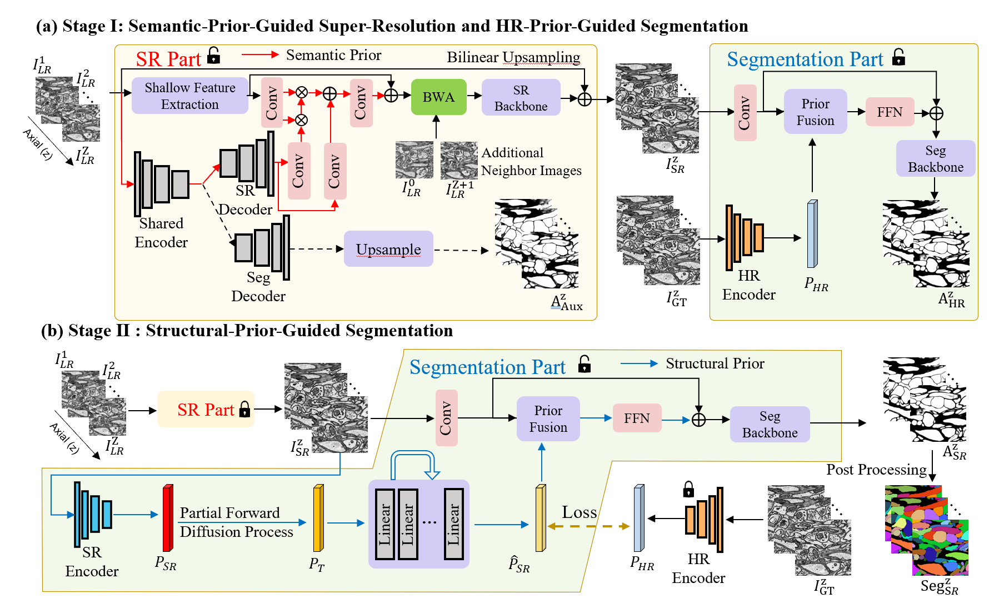

# EMSRSeg
## Joint EM Image Super-Resolution and Segmentation with Semantic and Structural Priors

**Accepted at NeurIPS 2026.**

**Jiateng Shou**, **Haoyuan Shi**, **Zhiwei Xiong** (corresponding author)

1. MoE Key Laboratory of Brain-inspired Intelligent Perception and Cognition, University of Science and Technology of China
2. Institute of Artificial Intelligence, Hefei Comprehensive National Science Center

Contact: shoujt@mail.ustc.edu.cn; zwxiong@ustc.edu.cn

Official implementation of our framework for joint EM image super-resolution and neuron segmentation.



## Environment

Linux, Python 3.7.12, PyTorch 1.13.1 and CUDA 11.7; dependencies are listed in
`requirements.txt`. MMCV-full requires compiled deformable convolution operators.
Install Waterz 0.9.4 separately with Cython, a C++ compiler and Boost headers.

## Pretrained models

Download the weights from [Google Drive](https://drive.google.com/drive/folders/1etjc9GlmVpj0bLdqlTZpp5rq6Sq0iSxF?usp=drive_link).

## Prepare data

Use aligned HR images and instance labels in HDF5 format. Prepared volumes use
key `main` and shape `[Z,H,W]`; images are uint8 and labels are nonnegative
integers, with 0 ignored. `prepare_data.py` center-crops to 1024 x 1024 and generates LR inputs.

```text
/data/emsrseg/
  wafer_gt/
    wafer{4,25,26,26_2,36,36_2}_inputs.h5
    wafer{4,25,26,26_2,36,36_2}_labels.h5
  cremi_gt/
    sample_{A,B,C}_20160501_inputs.h5
    sample_{A,B,C}_20160501_labels.h5
  wafer_bic_downsample_h5_x8/
  wafer_emfwd_downsample_h5_x4/
  cremi_bic_downsample_h5_x8/
  cremi_Noisy10_25bic_downsample_h5_x8/
  cremi_bic_downsample_h5_x16/
```

LR files use the same names as their HR inputs. For example:

```bash
python prepare_data.py \
  --input /source/sample_A.h5 --input-key volumes/raw \
  --labels /source/sample_A.h5 --labels-key volumes/labels/neuron_ids \
  --hr-output /data/emsrseg/cremi_gt/sample_A_20160501_inputs.h5 \
  --labels-output /data/emsrseg/cremi_gt/sample_A_20160501_labels.h5 \
  --output /data/emsrseg/cremi_bic_downsample_h5_x8/sample_A_20160501_inputs.h5 \
  --mode bicubic --scale 8
```

Adjust the source keys, paths and degradation for each volume:

| Setting | Degradation options |
|---|---|
| MEC x8 / CREMI A | `--mode bicubic --scale 8` |
| CREMI B | `--mode bicubic_noisy --scale 8` (Gaussian noise, sigma in [10,25]) |
| CREMI C | `--mode bicubic --scale 16` |
| MEC x4 | `--mode blur_shot --scale 4` (Gaussian PSF sigma=1.5, bilinear downsampling, Poisson peak=60) |

MEC uses wafer25/26/26_2/36 for training, wafer4 for validation and wafer36_2
for testing. CREMI uses the first 100 sections for training and the last 25 for evaluation.

## Training

Run Stage I, then Stage II, from the repository root:

```bash
python -m torch.distributed.launch --nproc_per_node=2 --master_port=4337 train.py \
  -opt configs/mec_bicubic_x8_cnn_stage1.yaml \
  --data-root /data/emsrseg --output outputs/mec_x8_stage1

python -m torch.distributed.launch --nproc_per_node=2 --master_port=4337 train.py \
  -opt configs/mec_bicubic_x8_cnn_stage2.yaml \
  --stage1-checkpoint outputs/mec_x8_stage1/52000_G.pth \
  --data-root /data/emsrseg --output outputs/mec_x8_stage2
```

Choose the matching files in `configs/` for other settings. To resume, add
`--resume outputs/<experiment>/<iteration>.state` with the same GPU count, batch size and workers.

## Testing

```bash
python infer.py \
  --config configs/mec_bicubic_x8_cnn_stage2.yaml \
  --data-root /data/emsrseg --output outputs/mec_x8_test
```

Use `--checkpoint` to select a checkpoint. MEC evaluates wafer4 and wafer36_2;
`--volume wafer4` or `--volume wafer36_2` selects one. CREMI uses the configured volume.

Results are saved under `<output>/<volume>/`: `sr/`, `seg/`, `segmentation.h5`
and `scores.json`. Waterz uses a threshold of 0.5.

## Computing metrics

Metrics are computed during inference. To recompute saved results:

```bash
python calculate_metrics.py \
  --sr-dir outputs/mec_x8_test/wafer36_2/sr \
  --hr /data/emsrseg/wafer_gt/wafer36_2_inputs.h5 \
  --segmentation outputs/mec_x8_test/wafer36_2/segmentation.h5 \
  --labels /data/emsrseg/wafer_gt/wafer36_2_labels.h5 \
  --output outputs/mec_x8_metrics.json
```

For CREMI, add `--z-start 100 --z-count 25`. PSNR/SSIM use BasicSR with
`crop_border=0`; VOI and ARAND ignore ground-truth label 0.
